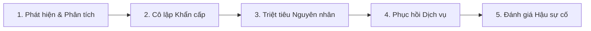

# QUY TRÌNH ỨNG PHÓ SỰ CỐ AN TOÀN THÔNG TIN (SECURITY INCIDENT RESPONSE RUNBOOK)
**Dự án:** Nền tảng LMS & E-Learning Web Application  
**Tiêu chuẩn:** NIST SP 800-61 Rev. 2 (Computer Security Incident Handling Guide)  
**Phiên bản:** 1.0 (Ban hành 31/10/2026)  

---

## 1. PHÂN CẤP MỨC ĐỘ SỰ CỐ (INCIDENT SEVERITY MATRIX)

| Mức độ | Định nghĩa | Tiêu chí nhận diện | Thời gian phản hồi (SLA) |
| :--- | :--- | :--- | :--- |
| **SEV-1 (CRITICAL)** | Hệ thống bị xâm nhập, rò rỉ dữ liệu diện rộng hoặc sập toàn bộ dịch vụ. | RCE, lộ Database PII, bẻ khóa Token Master, tấn công DDoS gây ngưng trệ hoàn toàn. | **<= 15 phút** |
| **SEV-2 (HIGH)** | Lỗ hổng nghiêm trọng bị khai thác cục bộ, gian lận chứng chỉ hoặc vượt quyền. | IDOR dữ liệu tài khoản khác, bypass Rate Limiter cạn kiệt ngân sách TTS, mã độc upload. | **<= 1 giờ** |
| **SEV-3 (MEDIUM)** | Cố gắng tấn công bất thành, lỗi cấu hình bảo mật hoặc tấn công dò quét từ chối. | Bot scan hàng loạt vào Honeypot, lỗi CSP reports tăng đột biến, phát hiện CVE dependency. | **<= 4 giờ** |
| **SEV-4 (LOW)** | Cảnh báo bảo mật thông thường, thông tin kỹ thuật hiển thị trong banner. | Quá hạn chứng chỉ SSL thử nghiệm, header bảo mật phụ trợ thiếu sót trên trang staging. | **<= 24 giờ** |

---

## 2. QUY TRÌNH PHẢN ỨNG 5 BƯỚC (NIST INCIDENT RESPONSE LIFECYCLE)

### Bước 1: Phát hiện & Định danh Sự cố (Detection & Analysis)
- Giám sát cảnh báo từ Cloudflare WAF, CloudWatch / Grafana Logs và hệ thống `_worker.js`.
- Kích hoạt kênh liên lạc khẩn cấp (War Room) trên Discord/Slack `#incident-security-war-room`.

### Bước 2: Cô lập Khẩn cấp (Containment)
- **Kích hoạt Cloudflare "Under Attack Mode":** Bật xác thực JavaScript Challenge / Turnstile trên toàn bộ domain để chặn đứng flood.
- **Thu hồi Phiên diện rộng:** Đẩy lệnh thu hồi token (`REVOKE_ALL_SESSIONS`) vào Redis Blacklist, hủy toàn bộ Refresh Tokens.
- **Khóa Endpoint bị ảnh hưởng:** Nếu phát hiện lỗi tại `/api/speech` hoặc `/api/quiz/grade`, chuyển hướng route sang mã lỗi 503 tạm thời tại Edge.

### Bước 3: Triệt tiêu Nguyên nhân (Eradication)
- Xoay vòng khóa bí mật (Rotate Secrets): Sinh lại toàn bộ `SPEECHGEN_TOKEN`, `ATTESTATION_SECRET`, và `SESSION_SIGNING_KEY`.
- Triển khai bản vá mã nguồn khẩn cấp qua nhánh `hotfix/*`.
- Chạy toàn bộ 11 bộ kiểm thử tự động tại `scripts/run_all_regression_tests.js` để xác nhận 100% All Green.

### Bước 4: Khục hồi Dịch vụ & Giám sát Tăng cường (Recovery)
- Mở lại dịch vụ theo từng phân vùng (Staged Rollout).
- Giám sát độ trễ (latency), tỷ lệ lỗi 4xx/5xx và lưu lượng truy vấn trong 48 giờ liên tục.

### Bước 5: Đánh giá Hậu sự cố (Post-Incident Review)
- Lập tài liệu **Blameless Post-Mortem** trong vòng 72 giờ: Nguyên nhân gốc rễ (Root Cause), mốc thời gian (Timeline), thiệt hại và các hành động phòng ngừa tương lai.

---

## 3. CÁC KỊCH BẢN XỬ LÝ KHẨN CẤP (EMERGENCY PLAYBOOKS)

### KỊCH BẢN A: RÒ RỈ KHÓA BÍ MẬT / SECRET LEAK
1. Lập tức thu hồi (Revoke) khóa cũ trên trang quản trị nhà cung cấp dịch vụ (Cloudflare / SpeechGen).
2. Sinh khóa mới có độ dài tối thiểu 256 bits (`SecurityEngine.generateCSPRNGToken(32)`).
3. Cập nhật khóa vào biến môi trường máy chủ bảo mật (`wrangler secret put SPEECHGEN_TOKEN`).
4. Khởi chạy quét mã nguồn `node scripts/run_security_audit_scan.js` để đảm bảo không còn tàn dư khóa cũ.

### KỊCH BẢN B: PHÁT HIỆN TỆP TẢI LÊN ĐỘC HẠI
1. Truy cập Cloudflare R2 / S3 Bucket và xóa vĩnh viễn tệp theo UUID.
2. Kiểm tra log tải lên xác định IP và danh tính tài khoản thực hiện.
3. Khóa vĩnh viễn tài khoản vi phạm và bổ sung IP vào IP Access Rules Blocklist của Cloudflare WAF.
4. Kích hoạt bộ quét ClamAV toàn diện trên toàn bộ Storage Bucket.

---
*Tài liệu được quản lý bởi IT Lead & CISO Taskforce.*
